# Awesome Starship Prompts

A curated collection of beautiful **Starship** prompt configurations, with screenshots and config links.

## 📂 Getting Started

**Starship** is a minimal, blazing-fast, and infinitely customizable prompt for any shell.

Its configuration lives in:

- `~/.config/starship.toml`: configures prompt appearance, symbols, colors, and behavior

> **Note**: The following configurations are tested with **Starship v1.23.0**.  
> Check the [Starship documentation](https://starship.rs/config/) for the latest details.

## 🚀 Prompt Gallery

A curated collection of beautiful and functional **Starship** prompts, with screenshots and config links.

### Tokyo Night

**Author:** [Official Preset](https://starship.rs/presets)  

[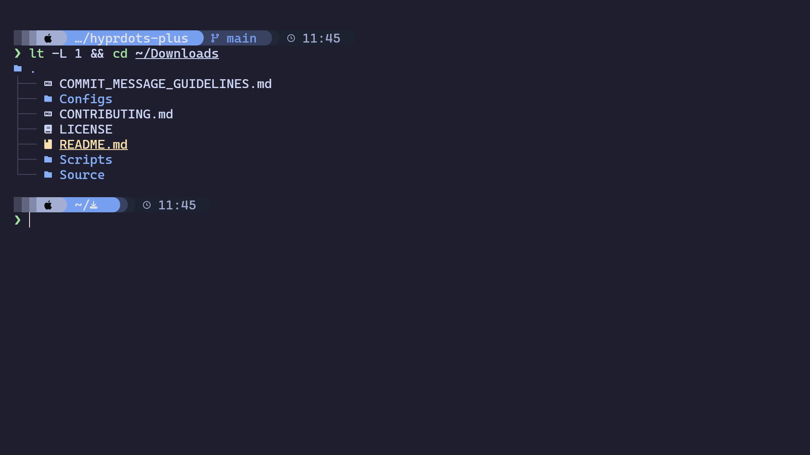](https://starship.rs/presets/tokyo-night)

---

### Pastel Powerline

**Author:** [Official Preset](https://starship.rs/presets)

[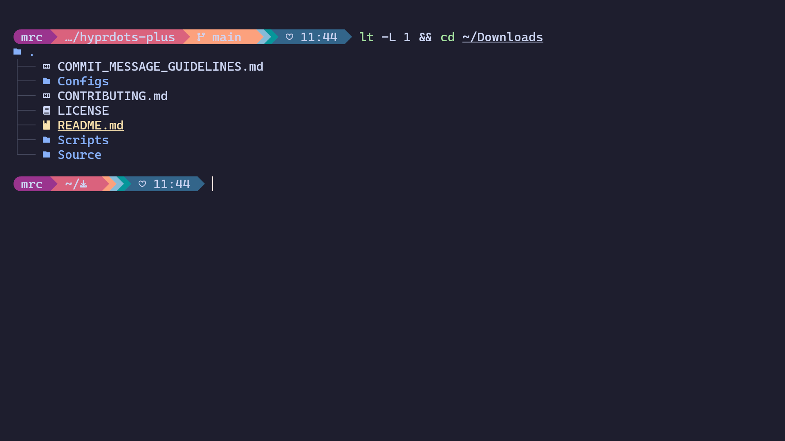](https://starship.rs/presets/pastel-powerline)

---

### Pure Prompt

**Author:** [Official Preset](https://starship.rs/presets)

[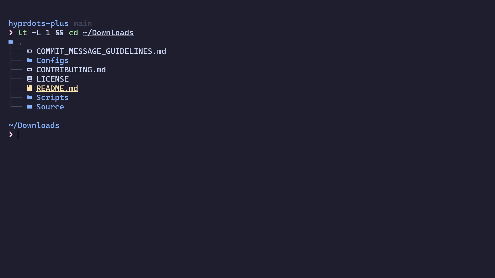](https://starship.rs/presets/pure-preset)

---

### Jetpack

**Author:** [Official Preset](https://starship.rs/presets)

[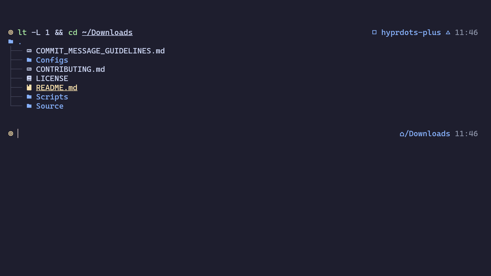](https://starship.rs/presets/jetpack)

---

### Gruvbox Rainbow

**Author:** [Official Preset](https://starship.rs/presets)

[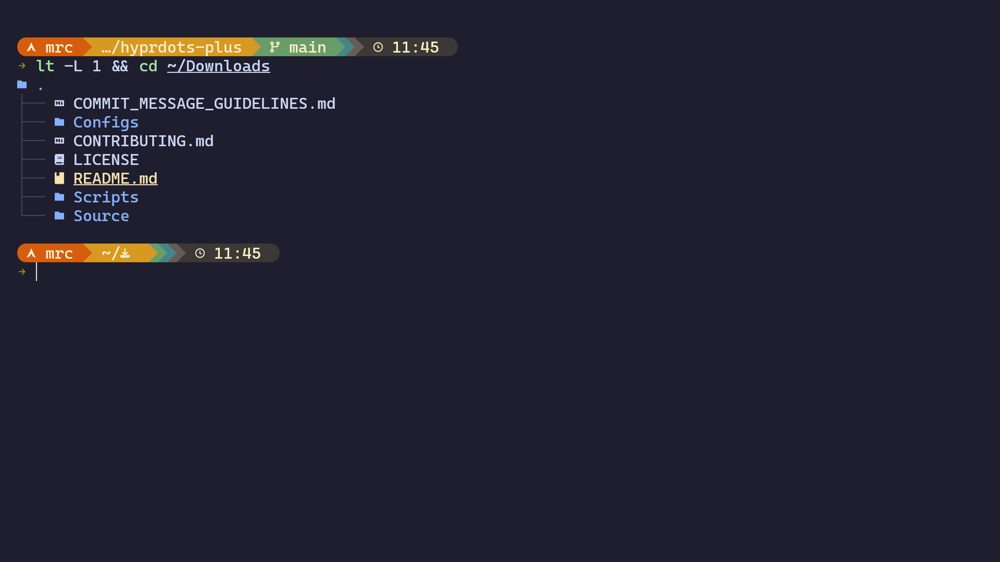](https://starship.rs/presets/gruvbox-rainbow)

---

### Catppuccin Powerline

**Author:** [Official Preset](https://starship.rs/presets)

[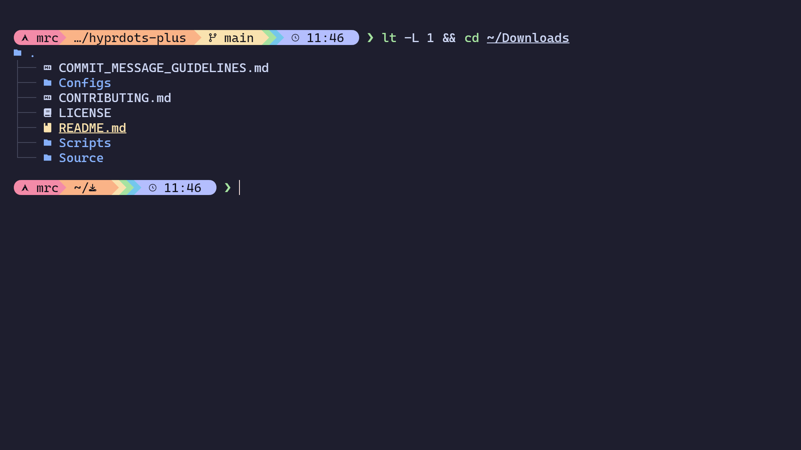](https://starship.rs/presets/catppuccin-powerline)

---

### HyDE

**Author:** [HyDE Project](https://github.com/HyDE-Project)

---

### Omarchy

**Author:** [Basecamp](https://github.com/basecamp)

[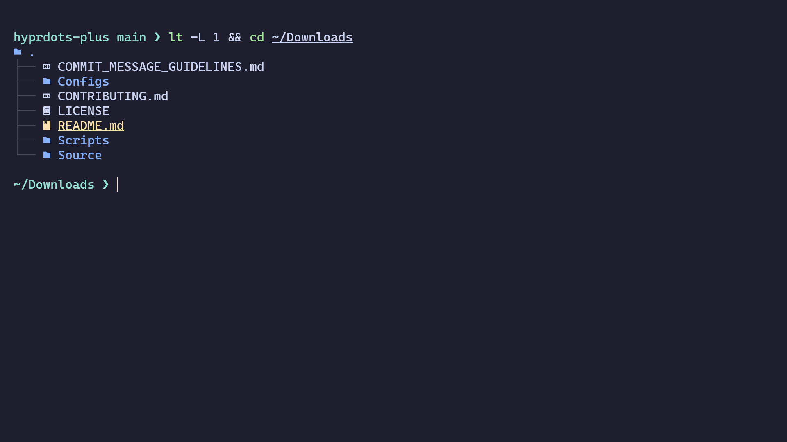](https://github.com/basecamp/omarchy/blob/master/config/starship.toml)

---

### End-4

**Author:** [end-4](https://github.com/end-4)

[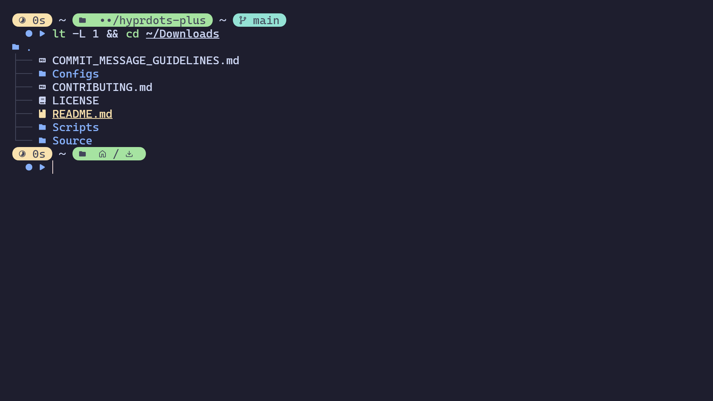](https://github.com/end-4/dots-hyprland/blob/main/.config/starship.toml)

---

### Zephyr

**Author:** [mattmc3](https://github.com/mattmc3)

[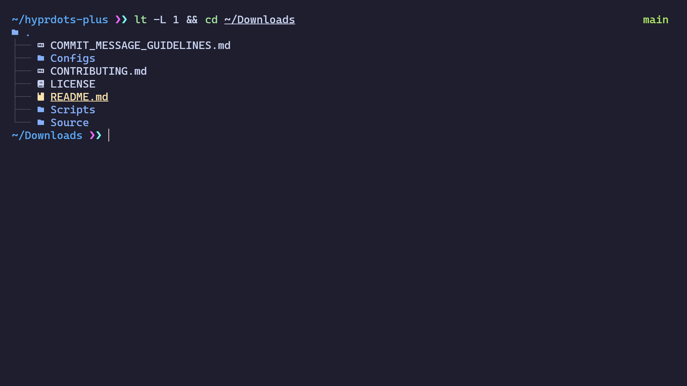](https://github.com/mattmc3/zephyr/blob/main/plugins/prompt/themes/zephyr.toml)

---

### Prezto

**Author:** [mattmc3](https://github.com/mattmc3)

[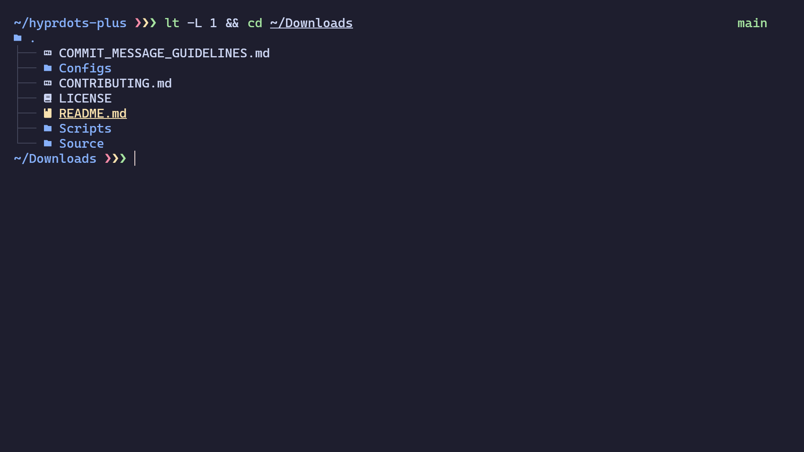](https://github.com/mattmc3/zephyr/blob/main/plugins/prompt/themes/prezto.toml)

---

### Hydro

**Author:** [mattmc3](https://github.com/mattmc3)

[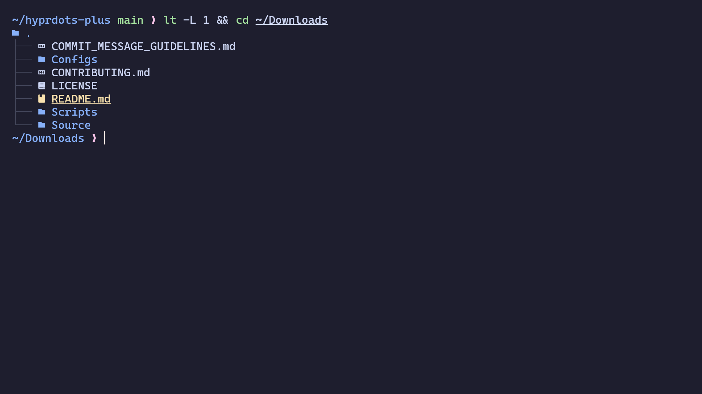](https://github.com/mattmc3/zephyr/blob/main/plugins/prompt/themes/hydro.toml)

---

### P3rception

**Author:** [Dimitris Pergelidis](https://github.com/p3rception)

[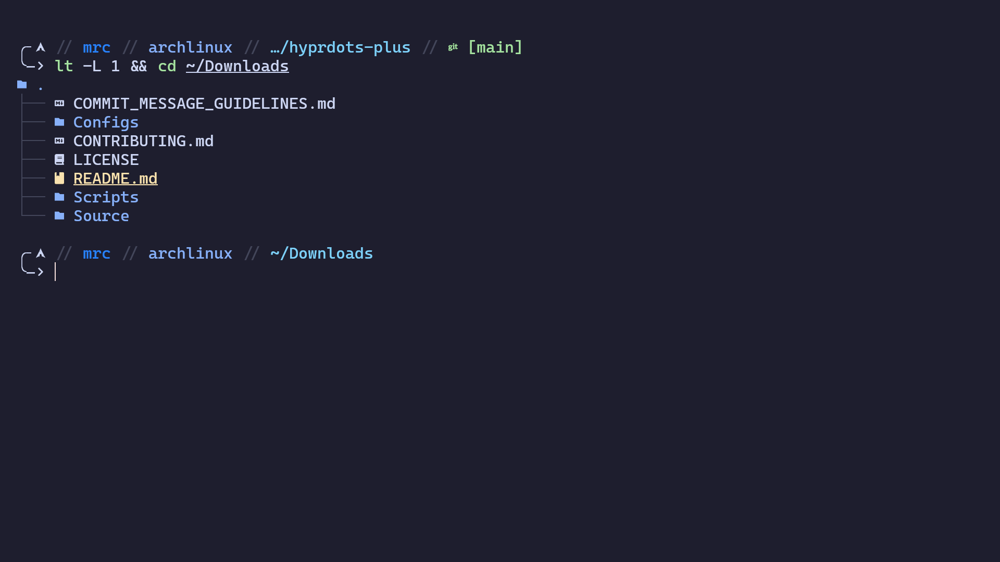](https://github.com/p3rception/dotfiles/blob/main/starship.toml)

---

### Christian Lempa

**Author:** [Christian Lempa](https://github.com/ChristianLempa)

[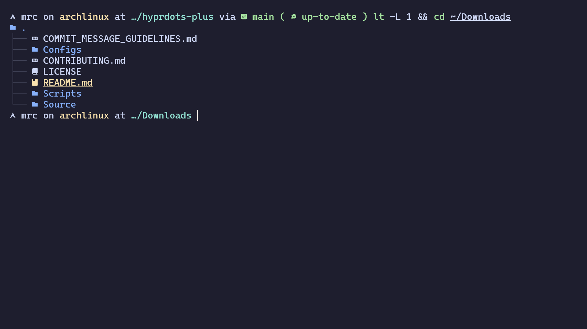](https://github.com/ChristianLempa/dotfiles/blob/main/.config/starship.toml)

---

### 1AmSimp1e

**Author:** [Nhan](https://github.com/1amSimp1e)

[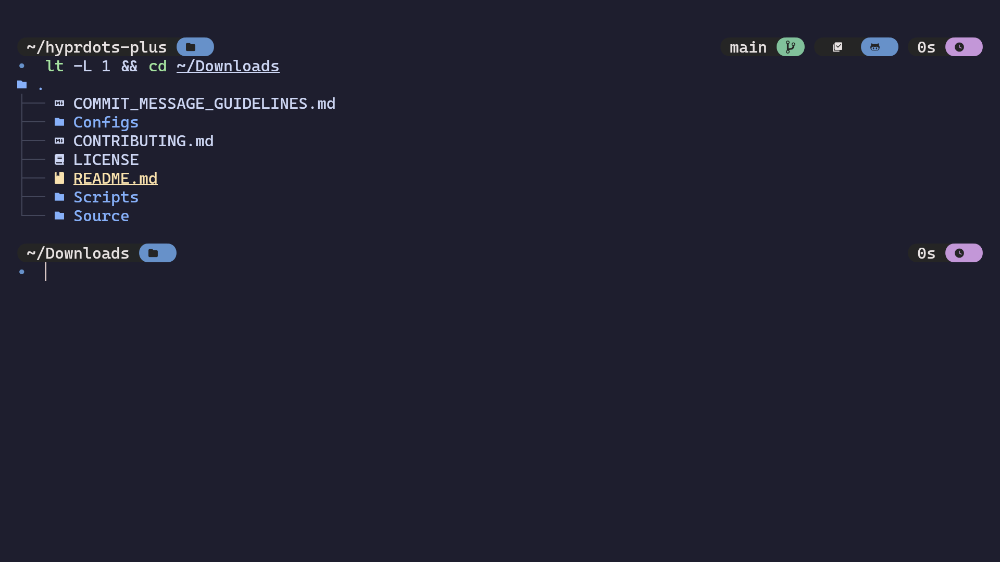](https://github.com/1amSimp1e/dots/blob/main/configs/prompt/starship.toml)

---

### LinuxMobile

**Author:** [L I N U X ( リナックス )](https://github.com/linuxmobile)

[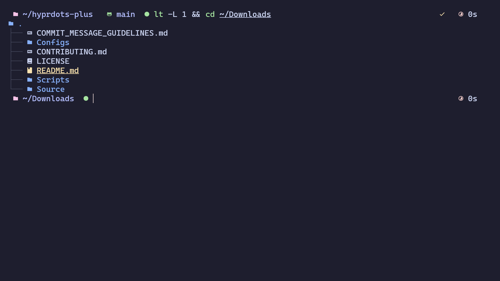](https://github.com/linuxmobile/hyprland-dots/blob/Sakura/.config/starship/starship.toml)

